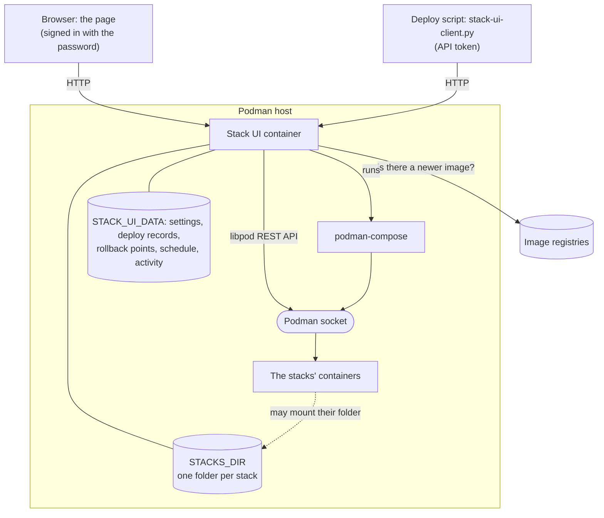

# Stack UI

A small web page for the compose stacks of a [Podman](https://podman.io) host. Every folder with a compose file is a
stack; Stack UI runs it with [podman-compose](https://github.com/containers/podman-compose) through the Podman socket.
One container, Python 3.14 (standard library) + PyYAML, no database.



The page's own state lives in `STACK_UI_DATA`, never in a stack's folder: a container that mounts its folder could
write it.

- **Stacks**: list with state, containers and their healthchecks; edit the compose and env file, or load a new version of them from
  your files (every save keeps the previous version in `.history/`, a save shows its diff first; a running stack is
  updated with every save, restore or file delete on the page, so its folder stays what runs); create, update
  (pull + recreate), start, stop, delete (the containers, and, if you tick it, the stack's folder too: the dialog lists
  what the folder holds first; a stack without containers can be deleted that way as well); an update keeps the
  previous state as a rollback point, and *Roll back…* returns the files, the image names and the containers to
  it (no download; volumes and host data are not touched);
  compare a stack with what was deployed last (the files of the last deploy are kept in the page's data folder,
  not in the stack's folder, which a container may mount and write); upload a new stack (its compose file, env file and other files chosen separately); update several stacks at once. One change runs at a time: a bar on every page shows it
  and, for a `podman-compose` command, offers *Cancel* (the command and what it started are stopped; the containers
  it already created stay); another change meanwhile is refused with a message that names the running one. The bar,
  and the dialog of an *Update*, *Create*, *Roll back* or *Pull*, shows how far it is: pulling images (how many of how
  many are done, and the layers so far: Podman gives no byte counts), recreating the containers, waiting for health
  checks (the automatic update). A
  command that does not finish in 5 minutes (`up`, `start`, `stop`, `down`; a pull gets 15) is ended, and the error
  names the containers that are not healthy yet.
- **A stack's other files**: the scripts, JSON/YAML configs and dashboards its compose file mounts with
  `./name` are saved with it, checked (syntax, no secret literals), versioned in `.history/`, compared with the
  last deploy, viewable and deletable on the page.
- **Image updates**: asks the registries (HEAD requests) whether a newer image exists for each running
  tag and marks the stacks. A private image is asked with the login of `REGISTRY_AUTH_FILE` (see *Configuration*), the rest anonymously. Once a day (04:00 by the server's clock unless changed on *Settings*; set `TZ`) it
  asks by itself. A stack whose *Automatic update* is switched on (its Summary tab) is then updated like *Update*
  does; an update whose containers do not come up is rolled back, that image version is not tried again, and a
  bar on every page says so. Nothing that needs a decision is done automatically (files that are not exactly
  the ones last deployed from the page, a stopped stack, a container in the way, the page's own stack), and
  nothing is sent anywhere. Of a partly stopped stack only the running services are updated. An update removes
  the images only the replaced rollback point kept (unnamed, unused; *Settings* switches it off). The stack list
  filters on *Automatic update* and switches it for the ticked stacks at once. A stack that was last deployed
  before 1.0.24 must be updated from the page once before the schedule touches it. Switch it on only for
  images you trust: the page does not verify signatures.
- **Containers**: every container, its stack, state and published ports (as links); start, stop, restart, logs,
  details (the inspect, secret-looking values masked), remove (only outside a stack).
- **Images**: sizes and users; pull, tag, remove (only unused: tick several to remove them at once, *Select untagged*
  ticks the leftovers of pulls).
- **Resources**: the CPU and memory of every running container and of the host; also on the Stacks list (a
  *Memory* column and a line with the host's RAM and CPU) and on a stack's Summary tab. A container near its
  memory limit turns yellow (80 %), then red (95 %). Refreshed every 10 seconds by default; *Settings* has the
  choice (off, 5, 10, 30, 60 seconds), kept in the browser. The page asks Podman for the numbers; nothing is
  stored.
- **Health**: the Pi in one place - CPU temperature (yellow from 70 °C, red from 80 °C, where a Raspberry Pi 4 slows
  down), load against the number of cores, memory, uptime, the file systems that hold the root, the stacks folder and
  any `STACK_UI_HEALTH_PATHS` (each file system once; yellow from 80 % full, red from 90 %), and what Podman holds.
  A container that keeps crashing looks "running" between two crashes: one that its restart policy started again
  3 or more times, the last within 10 minutes, is a *Restart loop* (red, on the Health page, in the header, on its
  stack and in Containers, and the stack counts as Unhealthy); the containers also show how often they were restarted.
  A container whose last exit was the kernel's out-of-memory kill (it reached its `mem_limit`) is marked *Out of
  memory*: raise its limit in the env file.
  Before that: a container whose readings show it at or above 90 % of its memory limit for 30 seconds gets a yellow
  *Memory near limit* (in the header and on the Health page); the usage leaves out the page cache the kernel can drop.
  The Stacks list shows the temperature, and a disk that is filling up, next to the host's RAM and CPU. What the
  container cannot read (no thermal zone in a virtual machine) shows as not available; the rest still works.
  On a Raspberry Pi it also reads the firmware's flags: under-voltage and throttling right now (red) or since boot
  (yellow), the usual sign of a weak power supply; the Stacks list shows a *Power problem* tag only then.
- **Checks before a deploy**: the dialog (and `stack-ui-client.py deploy`, also with `--dry-run`) stops with a plain
  message when an external network of the compose file does not exist, a host port is already published by another
  running container, or a Podman secret is missing; it only warns about an image name without a registry
  (`jc21/nginx-proxy-manager` instead of `docker.io/jc21/nginx-proxy-manager`) and a `${VARIABLE}` that has no value
  and no default. The env file's values and the `${VAR:-default}` forms are applied first.
- **Activity**: what happened, newest first. Every change, written when it ends: deploy, update, start / stop /
  delete, roll back, container, image, network, volume and secret changes, the automatic update, the backup; with
  its result (and error), how long it took and where it came from (*page*, *script*: the API token, *schedule*: the
  daily check). And what a watcher saw while no page may have been open (a look every minute): a restart loop
  starting and ending, an out-of-memory kill, memory near the limit (two looks in a row) starting and ending.
  Filters: changes, warnings, failed, one stack; a stack's Summary shows its last five. The newest 2000 entries
  are kept (`activity.jsonl`); the scripts' API token may read it (`GET /api/activity?show=&stack=&limit=`).
- **Logs**: a container's log, followed as it is written (*Follow*; *Pause*, *Jump to latest*, a filter that marks
  its matches, errors red and warnings yellow, *Download* of what the page holds: its last 5000 lines),
  **Networks**, **Volumes** and **Secrets** (Podman secrets: a value goes in and is never shown again).
- An **API token** for scripts, and `client/stack-ui-client.py` that deploys a folder through the API.

## How stacks are found

A stack is a direct subfolder of `STACKS_DIR` named like a podman-compose project (lowercase letters, digits, `-`
and `_`) that holds a compose file:

1. the one `stack.json` names: `{"compose": "my.yaml", "env": "my.env"}` (`env` may be `null`);
2. else the first of `compose.yaml`, `compose.yml`, `docker-compose.yml`, `docker-compose.yaml`;
3. else its only `*.yaml` / `*.yml` (two or more unknown YAML files and no `stack.json`: not a stack).

The env file is `stack.json`'s, else `.env`, else the only `*.env`, else none.

A stack runs **without a pod**, like Docker Compose (so `userns_mode: keep-id` and the like work), unless its
compose file says otherwise: `x-podman: {in_pod: true}` (or a pod name).

A stack's **other files** are the rest of its folder with one of the suffixes `.yaml .yml .env .sh .md .txt
.json` (flat: no subfolders; at most 512 KiB each). A save or an upload checks them: JSON and YAML must parse,
and a secret-looking key (`*TOKEN`, `*PASSWORD`, `*SECRET`, `*API_KEY`, …) must not hold a literal value —
references are fine: `${VAR}`, `$__file{/run/secrets/x}`, `$__env{VAR}`, `/run/secrets/x`. `.sh` files are made
executable. Hidden folders and the names in
`STACK_UI_IGNORE` are skipped. A stack runs as the podman-compose project of its folder's name, from the folder
(relative paths in the compose file resolve there).

## Install

On the Podman host:

```bash
# 1. the Podman socket (rootful)
sudo systemctl enable --now podman.socket
# 2. the page's password (at least 10 characters): only its hash goes into a Podman secret
read -rs -p 'Stack UI password: ' PW; echo
printf '%s\n' "$PW" | sudo podman run --rm -i ghcr.io/pusztaia/stack-ui:1 --hash-password | sudo podman secret create stack-ui-password -
unset PW
# 3. the example compose file
curl -LO https://raw.githubusercontent.com/pusztaia/stack-ui/main/compose.example.yaml
# 4. where your stacks are, and how you open the page
export STACKS_DIR=/srv/stacks STACK_UI_ALLOWED_HOSTS=127.0.0.1,localhost
# 5. start it
sudo -E podman-compose -f compose.example.yaml up -d
```

Open `http://127.0.0.1:8770` on that host (or through an SSH tunnel). To open it on the LAN, change the port line
to your host's address (e.g. `192.168.1.10:8770:8770`) and add that address to `STACK_UI_ALLOWED_HOSTS`; better,
put it behind a reverse proxy with HTTPS.

**Rootless:** the same without `sudo`: `systemctl --user enable --now podman.socket`, and in the compose file use
the commented socket line (`/run/user/<your UID>/podman/podman.sock`).

Updates: `podman-compose -f compose.example.yaml pull && podman-compose -f compose.example.yaml up -d`. The tag
`:1` follows every 1.x release; pin `:1.0.0` for a fixed version.

### From another computer (Windows PowerShell, macOS, Linux)

`tools/install-pi.py` does the steps above over SSH, with the `ssh` of your computer (Windows 11 has it) and
Python 3.14 or newer there (standard library only):

```powershell
python tools\install-pi.py                                 # interactive: asks the host, rootful / rootless, port ... then goes on
python tools\install-pi.py ubuntu@192.0.2.10 --dry-run   # the plan and the script, nothing is sent
python tools\install-pi.py ubuntu@192.0.2.10             # install: asks the page's password, then the host's
python tools\install-pi.py ubuntu@192.0.2.10 --update    # pull and recreate an install made by it
```

It finds out whether the host runs Podman rootful or rootless (`--rootful` / `--rootless` to say it), enables the
socket, creates the `stack-ui-password` secret from a hash made on your computer (the password itself is never
sent), writes `~/stack-ui/compose.yaml` (with the hardening of `compose.example.yaml`) and starts it. It changes
nothing when a container named `stack-ui` already runs. `--build` builds the image on the host from this
repository; `--trusted-proxies`, `--allowed-hosts`, `--stacks-dir`, `--loopback` and the rest: `--help`.

## Rootful or rootless?

| | Rootful | Rootless |
|---|---|---|
| Who reaches the socket gets | root on the host | your user's rights |
| Ports below 1024 | yes | needs `net.ipv4.ip_unprivileged_port_start` |
| `privileged`, devices, `network_mode: host` | full | limited |
| Files of bind mounts on the host | the container's UIDs | shifted UIDs (subuid) |
| Networking | native | slower (pasta/slirp) |

Prefer **rootless** where your stacks allow it. Use **rootful** when a stack needs `privileged` containers,
devices or ports below 1024 — and then remember that this page is as powerful as root on that host.

## Security

- Whoever controls the page controls your containers: with a rootful socket that is root on the host.
- Off loopback the page needs a password (its PBKDF2 hash in the `stack-ui-password` Podman secret), a session
  cookie (HttpOnly, SameSite=Strict, 12 h; Secure behind a trusted https proxy), the page's token, and an allowed Host header
  (`STACK_UI_ALLOWED_HOSTS`). Five wrong passwords lock an address out for a few minutes.
- The port binds to `127.0.0.1` by default. Use HTTPS (a reverse proxy) when you open it on a network.
- Env files must not hold secrets: a save or an upload with a non-empty `*TOKEN` / `*PASSWORD` / `*SECRET` /
  `*API_KEY` variable is refused. Give a stack a secret as a Podman secret: in its compose file
  `secrets: {my_secret: {external: true}}` (and under the service), created on the *Secrets* page.
- The page's own container (`STACK_UI_SELF`) and its compose project, and `STACK_UI_PROTECTED`, are never stopped,
  restarted, redeployed or removed from the page; the `stack-ui-password` secret (and `STACK_UI_PROTECTED_SECRETS`)
  is never removed.
- Running as root (rootful), files the page writes into `STACKS_DIR` get the owner of their folder, so the stacks
  stay editable by their owner.

## Configuration

| Variable | Default | |
|---|---|---|
| `STACKS_DIR` | — (required) | the stacks folder; mount it at the same path in the container |
| `STACK_UI_ALLOWED_HOSTS` | `127.0.0.1,localhost` | the host names / addresses the page answers to |
| `STACK_UI_PASSWORD_FILE` | `/run/secrets/stack-ui-password` | the password hash (`--hash-password`) |
| `STACK_UI_SELF` | the container's `HOSTNAME` | this page's container name (protected) |
| `STACK_UI_PROTECTED` | — | more containers or compose projects that are never stopped or removed |
| `STACK_UI_PROTECTED_NETWORKS` | `podman` | networks that are never removed |
| `STACK_UI_HEALTH_PATHS` | — | More paths whose file system the Health page shows (comma separated; they must be mounted into the container) |
| `STACK_UI_PROTECTED_SECRETS` | — | Podman secrets that are never removed (besides `stack-ui-password`) |
| `STACK_UI_TRUSTED_PROXIES` | — | addresses / networks of the reverse proxies in front of the page (e.g. `172.18.0.0/16`): their `X-Forwarded-For` tells the login throttle who the client is; without it every client behind a proxy counts as the proxy |
| `STACK_UI_UP_TIMEOUT` | `300` | seconds a `podman-compose` `up` / `start` / `stop` / `down` may run before it is ended (at least 30) |
| `STACK_UI_IGNORE` | — | folders of `STACKS_DIR` that are not stacks |
| `STACK_UI_HIDE_UNDEPLOYED` | `false` | `true`: the Stacks page lists only the stacks that have containers (a new one shows up once created; its own page opens after *Add stack*) |
| `STACK_UI_DATA` | `/data` | where the settings (the API token's hash), the files of each stack's last deploy, the rollback points and the schedule's state are kept; keep it a volume no stack mounts, and back it up (see *Backup*) |
| `REGISTRY_AUTH_FILE` | — | a `podman login --authfile` file: Podman pulls private images with it, and the update check asks a private image's registry with the login it holds for that registry (sent only to a token address on the registry's own host, over https) |
| `PODMAN_SOCKET` | `/run/podman/podman.sock` | the Podman socket inside the container |
| `STACK_UI_BIND`, `STACK_UI_PORT` | `0.0.0.0`, `8770` | where the page listens in the container |
| `STACK_UI_BACKUP_DIR` | — | a folder in the container (mount a host folder there) where *Settings > Backup > Save on the server* writes; without it only the download is offered |
| `STACK_UI_BACKUP_KEEP` | `10` | how many of its backups the page keeps in `STACK_UI_BACKUP_DIR` (the newest; nothing else there is touched) |

## Backup

The page keeps its own state in its data folder (`STACK_UI_DATA`, `/data` in the container):

| | |
|---|---|
| `settings.json` | the API token's hash |
| `schedule.json` | the daily check: its time, the stacks switched to *Automatic update*, the hashes of each stack's files as last deployed from the page, the image versions that failed, the last runs |
| `activity.jsonl`, `activity-watch.json` | the Activity log (the newest 2000 entries), and what its watcher saw last |
| `deployed/<stack>/` | the files of each stack's last deploy (*Differs*, the *Diff* tab) |
| `rollback/<stack>/` | each stack's rollback point |

Lost, the page still works, but every stack shows *Unknown* until its next *Update*, no stack has a rollback
point, the automatic update holds back every stack until it is updated from the page once, and the scripts need a
new API token.

It does not hold (back these up your own way): the stacks folder `STACKS_DIR` (the compose and env files and
their `.history/`); the page's password hash (the `stack-ui-password` Podman secret, or the file your compose file
mounts); the values of Podman secrets (Podman does not give them out: keep them where you made them); the stacks'
own volumes; the images. A rollback point needs its old image on the host: on a new host, *Roll back* says the
image is missing.

*Settings > Backup* makes it: *Download backup* gives a `stack-ui-backup-<date>-<time>.tar.gz` to the browser
(it survives the loss of the host), *Save on the server* writes it into `STACK_UI_BACKUP_DIR` (readable by its
owner only: it holds the API token's hash) and keeps the newest `STACK_UI_BACKUP_KEEP`. It waits for no change to
be running (*Busy* otherwise), so it never holds a deploy half way. The archive holds the files above and
`stack-ui-backup.json` (the version and the time).

By hand instead, while no change runs (the bar at the top of the page is empty). With rootful Podman, run the
commands with `sudo`. First, where `/data` comes from: a volume (`volume <name> …`) or a host folder
(`bind  <path>`):

```bash
podman inspect stack-ui --format '{{range .Mounts}}{{if eq .Destination "/data"}}{{.Type}} {{.Name}} {{.Source}}{{end}}{{end}}'
```

A volume (Podman 4 or later):

```bash
podman volume export --output stack-ui-data.tar <name>
```

A host folder:

```bash
tar -C <path> -czf stack-ui-data.tar.gz .
```

To restore (a backup from the page, or one made by hand), stop the page, put the files back, and start it again.
A backup from the page unpacks into the data folder as it is (`stack-ui-backup.json` can stay or go):

```bash
podman stop stack-ui
podman volume import <name> stack-ui-data.tar     # a volume: the files are added to what is there
tar -C <path> -xzf stack-ui-data.tar.gz           # a host folder
podman start stack-ui
```

(The `podman volume export` / `import` lines follow Podman's documentation; they were not run against a real
Podman while this was written.)

## Deploy from a script

Generate an API token in *Settings*, then from any machine with Python 3.14 or newer (standard library only):

```bash
export STACK_UI_URL=http://my-host:8770 STACK_UI_API_TOKEN=...
python client/stack-ui-client.py deploy ./my-app --dry-run   # the differences and the plan
python client/stack-ui-client.py deploy ./my-app             # save the files there, then create or update
```

It sends the stack's other files too, and lists the files that exist only on the host (delete them on the page
if they are not needed).

The token opens the API except the settings, never the page.

## Development

Python 3.14, and Node.js for the tests that run the page's script (they are skipped without it):

```bash
pip install pyyaml -r requirements-dev.txt
ruff check .                              # the linter (rules in ruff.toml), as the CI runs it
python -m unittest discover -s tests -v   # the whole suite
```

The tests use a mock libpod API and a fake podman-compose, never a real Podman. What a real Podman answers is
checked against a cut-down sample of one (`tests/fixtures/podman-5.7`, made by `tools/podman-sample.py`).

## License

MIT
